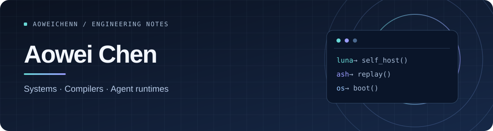

  

  正在构建 <strong>Nova</strong>：一个以 C++20 为核心的 AI Agent 工作台。 
  Building an agent workbench with a C++20 runtime and a TypeScript web interface.

  <a href="https://aoweichenn.github.io/">Visit the Nova site ↗</a>

---

### Nova

Nova 探索如何把 Agent 运行时、工具调用与会话管理连接到网页、终端工作台和脚本 CLI。项目仍在设计与原型迭代阶段。

> **Focus** · C++20 runtime · TypeScript web interface · terminal and CLI workflows
